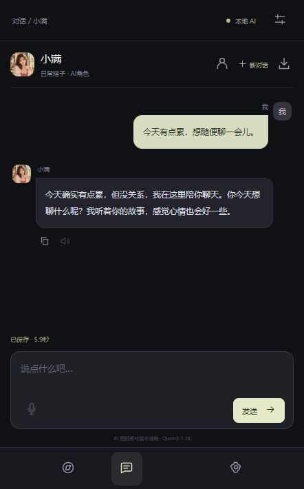

# 拾语：Qwen3 本地角色聊天与语音实验

面向 IM 大模型开发岗位的个人项目，将本地 Qwen3-1.7B、角色聊天网页、语音功能、LoRA 微调实验和 MNN 手机端推理结合在一个代码仓库中。项目仍在完善，下面区分实际完成与尚待验证的部分。

## 界面展示

以下是当前版本的实际运行截图，使用独立演示会话；截图为窄屏显示，聊天回答由本机 Qwen3-1.7B 生成。





| 项目证据与当前边界 |
| --- | --- |
| Qwen3、PyTorch、LoRA | 真实训练 Qwen3-1.7B LoRA，记录训练配置与基础模型对照；最新候选尚未通过开发质量门槛。 |
| IM 对话与工程 | 自有网页、FastAPI、SQLite、SSE 流式回答、角色卡和会话管理；单用户原型。 |
| MNN-Chat 与权重优化 | 自行转换基础模型为 MNN Q4，并通过上游 MNN Chat 在手机本地运行；不是自研手机 App。 |
| 语音整合 | 电脑端接入识别与 GPT-SoVITS 朗读；手机语音由上游 MNN Chat 提供，延迟及准确率尚未系统测量。 |
| vLLM、AutoGPTQ、Linux 与高并发 | 尚未完成；独立使用过 GPTQModel 量化，不等同于使用 AutoGPTQ。 |

## 已完成

- **聊天应用**：自有网页、FastAPI、SQLite，多轮聊天、SSE 流式输出、会话管理、角色卡和关键词世界书；支持生成和编辑角色档案、查看提示，以及同会话记忆整理和编辑。
- **语音**：电脑端提供语音识别和回答朗读，并接入 GPT-SoVITS 角色音色；作者提供的参考音频未公开。合成延迟尚未系统优化。
- **LoRA 实验**：在 RTX 4060 Laptop 8GB 上实际训练 Qwen3-1.7B 适配器，参考 RoleLLM 的角色条件化思路，以 PEFT 和项目训练循环实现。最近一轮开发对照未通过质量门槛，未证明整体质量提升；完整结果见 [实验记录](docs/完整角色提示控制实验结论.md)。
- **MNN 端侧**：从官方 Qwen3-1.7B 权重自行导出 MNN 4-bit 模型，用上游 MNN Chat 在一加 Ace 5 手机本地运行；作者确认文字、语音识别和语音回答可用。
- **GPTQ**：通过 GPTQModel 做过独立 4-bit 量化尝试，当前 Windows 推理后端较慢，未接入聊天应用。

项目是本地单用户原型，尚未完成高并发、vLLM、TensorRT-LLM、Linux 部署、自研 Android 应用和严格的端侧性能评测。未提供在线 Demo，模型及语音权重需单独获取；干净机器上的完整复现尚未完成。

## 运行电脑端

已使用 Windows、Python 3.11、CUDA 和 RTX 4060 Laptop 8GB。首次安装和下载需要网络。

```powershell
conda create -n qwen3-im-chat python=3.11 pip
conda activate qwen3-im-chat
python -m pip install torch==2.13.0 --index-url https://download.pytorch.org/whl/cu126
python -m pip install -r requirements-lock-windows-py311.txt
python src/fetch_chat_model.py
python launch_app.py --model-profile qwen3-1.7b --speech-provider off
```

访问 http://127.0.0.1:8000/ui/，接口文档为 http://127.0.0.1:8000/docs。语音模型和 GPT-SoVITS 需另外配置，不随仓库提供。安装版本与环境的兼容性仍需在新机器上复核。

## 架构和实验

```text
浏览器网页 → FastAPI → Qwen3-1.7B / LoRA（实验）
                    ├→ SQLite 会话和角色
                    └→ ASR / TTS 语音服务
手机 → 上游 MNN Chat → 自行转换的 MNN 模型
```

- [架构说明](docs/architecture.md) · [API 说明](docs/api-guide.md)
- [角色卡、世界书与会话记忆](docs/角色卡与会话记忆.md)
- [LoRA 训练记录](docs/首轮RoleLLM适配LoRA实验记录.md) · [开发对照结果](docs/完整角色提示控制实验结论.md)
- 脚本 `scripts/export_qwen3_mnn_3_5_0.ps1` 记录转换入口；实际导出依赖另行配置的 MNN 工具与原始模型。

## 代码目录

- `web/`：网页界面和角色图片。
- `src/backend.py`、`src/inference.py`、`src/storage.py`：接口、模型推理、SQLite 持久化。
- `src/character_cards.py`、`src/prompt_pipeline.py`、`src/session_memory.py`：角色卡、提示组装与同会话记忆。
- `src/train_lora.py`、`src/training_data.py`、`src/training_recipe.py`：LoRA 训练与数据处理；`src/` 也包含依赖的历史处理模块。
- `scripts/`：近期实验、MNN 转换等工具；`experiments/legacy/`：历史实验和检查脚本，路径整理后未逐一复验。
- `docs/`：架构、API 和实验记录；`tests/`：项目测试。

仓库不包含模型权重、Adapter、训练语料、个人录音、聊天数据库或本地环境。部分实验脚本需要另行准备未公开的数据；当前提供的是代码和实验结果摘要，不能宣称完整训练可立即复现。


同会话记忆由模型从旧消息中挑选原文片段，并可查看、编辑和恢复；它可能遗漏重要信息，不能保证长对话完全一致。新会话不继承旧会话的动态记忆。重复回复处理仅影响发送给模型的上下文，不删除数据库原记录。

## 许可

项目代码按 [AGPL-3.0](LICENSE) 提供。Qwen、MNN、GPT-SoVITS、依赖库和训练数据遵循各自的上游许可证；本仓库不包含这些第三方项目的完整代码和模型。界面参考了 SillyTavern 的角色卡与世界书功能理念。
