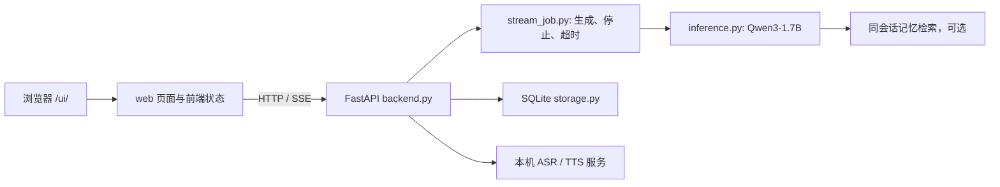
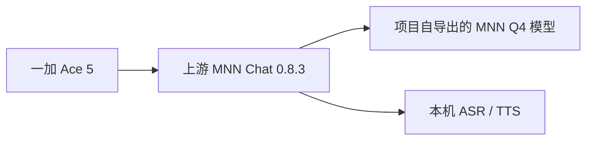
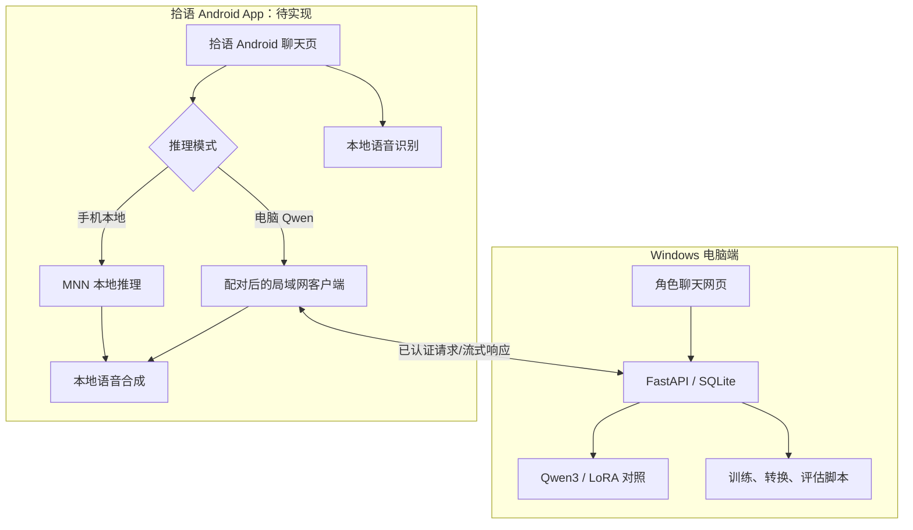

# 拾语项目架构

## 当前电脑端

电脑端由浏览器页面、FastAPI 服务、Qwen3 推理和 SQLite 组成。浏览器不直接加载模型，模型只在后端进程中加载一次。默认展示基座模型；历史 LoRA 可作为实验模式启动，但不能据此宣称质量稳定提升。

页面请求由 `web/index.html`、`web/app.js` 和样式文件提供；后端在 `/ui/` 提供页面，并提供会话、聊天、流式输出和语音接口。完整路径与示例见 [API 指南](api-guide.md)。数据库只保存本机聊天会话与消息；生成失败时不保存半轮对话。应用是单机单用户原型，生成任务通过进程内锁串行管理，不等同多进程高并发服务。

## 当前手机端验证

项目从固定的 `Qwen/Qwen3-1.7B` revision 使用 MNN 3.5.0 exporter 转换为 4-bit、block64 模型，已在一加 Ace 5 上由 MNN Chat 0.8.3 本地加载并生成回复。用户也报告 MNN Chat 的语音识别和语音回答可用。这些是上游 App 中的验证，不代表拾语 Android App 已完成。

这证明了项目模型可在手机端运行，但 MNN Chat 仍是第三方验收工具。当前还没有本项目 Android 客户端，也没有将角色、聊天历史、语音和 MNN 推理合并到一个自有手机 App 中。MNN 4-bit 配置不是 GPTQ；项目尚未将 GPTQ、AutoGPTQ 或 vLLM 接入主应用。

## 求职 Demo 的目标形态

同一代码仓提供电脑实验/聊天入口和 Android 客户端。手机有两种明确的推理模式：本地模式在设备上运行 MNN 模型；电脑模式经用户配对后，通过局域网连接电脑 Qwen。手机的 ASR/TTS 在手机上运行：本地模式是 ASR → MNN → TTS；电脑模式是 ASR → LAN Qwen → 手机 TTS。两种模式聊天历史独立保存，不做账号或云端同步。电脑 LAN 服务默认关闭，仅在用户明确开启并完成配对后接受请求。

电脑服务提供可选的 LAN 模式：默认绑定 `127.0.0.1`；显式开启后使用单独的配对/鉴权接口，显示配对码并允许撤销设备令牌，不能把当前无认证开发接口直接暴露给局域网。离线本地模式不要求电脑在线。演示应展示同一角色的本地/电脑文字对话、手机语音往返、断网行为和模式状态，并提供 README、接口说明、模型转换与许可记录、已知限制和演示视频。具体验收见[项目主计划](IM岗位项目主计划与验收标准.md)和[Android 双模式连接设计](Android双模式连接设计.md)。

## 核心模块

| 文件/目录 | 职责 |
|---|---|
| `web/` | 浏览器聊天页、交互状态、角色视觉素材 |
| `backend.py` | FastAPI 路由、会话状态、输入校验与语音接口 |
| `inference.py` | Qwen3 模型加载、提示构造和生成；支持可选 LoRA/记忆实验 |
| `stream_job.py` | SSE 任务生命周期、停止请求、超时和完成提交 |
| `storage.py` | SQLite 会话与消息的事务式保存 |
| `characters.py`、`role_knowledge.py` | 角色卡、角色身份规则和可检索资料 |
| `same_chat_memory.py`、`context_window.py` | 单会话裁剪后回忆原先对话内容 |
| `train_lora.py`、`training_data.py` | LoRA 训练及监督标签准备 |
| `evaluate_*.py`、`compare_*.py` | 评测案例、原始生成和结果对照；各文件对应的当前/历史状态见实验文档 |
| `scripts/export_qwen3_mnn_3_5_0.ps1` | 从固定 Qwen3 checkpoint 导出 MNN Q4 block64 模型 |
| `scripts/push_self_exported_mnn_to_phone.ps1` | 将自导出模型传到已连接的 Android 设备 |

## 系统边界

当前 Windows 服务是单机本地开发版，未部署 vLLM、TensorRT-LLM、GPTQ 或分布式训练；没有账号、云同步和生产级并发保证。手机端的自有 App 尚待实现。项目代码采用 MIT；模型、数据、语音模型和第三方代码各自遵循其上游许可。
