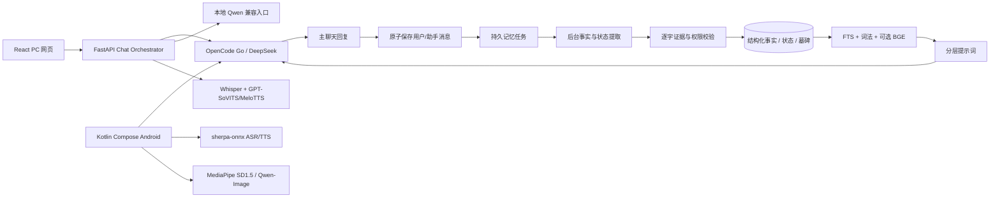

# 拾语项目现状与网页端建议落实审计

更新：2026-10-30

## 一、结论

拾语当前已经不是单页模型演示，而是一套可运行的单用户虚拟角色聊天系统：

- PC 使用 React + FastAPI + SQLite，适合作为服务端、调试台和完整功能载体。
- Android 使用 Kotlin + Jetpack Compose + Room，直接连接 OpenCode Go 或 DeepSeek，不依赖电脑。
- 两端都具备角色卡、世界书、唯一持续对话、流式回答、图片输入、长期记忆、角色删除与重置。
- PC 已完成自动记忆闭环、FTS5 + 本地 BGE 混合检索、内部状态。
- Android 已完成自动记忆、FTS4 + 词法检索、内部状态和主动开场；尚未内置 BGE 与完整会话摘要管理。
- 两端都支持语音。PC 是 Whisper + GPT-SoVITS/MeloTTS；Android 是本地 sherpa-onnx ASR + Kokoro TTS。
- Android 继续保留 MediaPipe SD1.5 本地生图和千问 Qwen-Image 云端生图；PC 网页端本地生图已移除。

从求职 Demo 角度看，工程广度已经明显超过“只会调用 API 的聊天框”。主要短板已经转移到：

1. 模型真实质量、角色自然度和长期一致性的评测证据不够。
2. 反射式记忆、人物成长和主动目标系统尚未实现。
3. PC 与 Android 数据不互通，没有账号体系和多用户隔离。
4. 生产部署、监控、完整迁移管理和损坏恢复仍不充分。
5. 部分核心文件过大，后续迭代和面试讲解成本较高。

## 二、整体架构

核心原则是：

- 大模型负责理解、生成和候选取值。
- 程序负责事实状态、权限、版本、有效时间、限幅、衰减和持久化。
- 当前用户消息优先于旧记忆。
- 固定角色卡和知识边界优先于普通聊天中的即兴内容。
- 后台记忆任务不阻塞当前回答。

## 三、PC 网页端实现

### 3.1 聊天与会话

- 前端位于 `frontend/`，构建产物由 FastAPI 从 `/ui/` 提供。
- 每个角色只有一个持续会话，由 `role_conversations` 表绑定。
- 创建或打开空会话时，服务端原子插入一次角色主动开场；重复打开不会重复插入，重置后会重新出现。
- `/chat/stream` 使用 SSE 返回增量文字。
- 停止生成通过取消任务实现，只有完整成功的一轮才在同一聊天数据库事务中保存用户消息和助手消息。
- 图片先上传、校验 MIME/尺寸、去除元数据并转成 WebP；聊天时以图片 URL内容发送给支持视觉的云端模型。
- 角色回复是一条自然聊天消息，动作放在中文括号中；不再显示四段式标题、内心栏或好感度栏。
- TTS 只读取保存的聊天正文，并去掉括号动作。

### 3.2 模型 Provider

`src/providers.py` 定义统一的 Provider 能力：

- OpenCode Go：默认模型 `deepseek-v4.1-flash`。
- DeepSeek：备用模型 `deepseek-flash`。
- 本地 Qwen：保留文字兼容入口，产品页面当前隐藏。
- Provider 支持普通请求和流式请求，解析 usage、缓存命中、OpenCode allowance/cost 等信息。
- 请求关闭 Thinking，结构化记忆使用 JSON 模式。
- 请求超时、配置缺失、限流和响应错误分别转换为明确的应用错误。

### 3.3 角色系统

角色卡包含：

- 名字、标签、简介、背景。
- 性格、说话方式、与用户关系。
- 开场剧情、创作动机、互动边界。
- 知识边界：角色类型、时代、知识截止、世界范围、允许/禁止知识、禁止词。
- 固定事实及其确认状态。
- 世界书条目和触发关键词。
- 示例对话和生成参数。

模型只能看到服务端组装后的角色系统提示，浏览器不能提交伪造 System Prompt。角色生成是先产生 JSON 草稿，再由作者检查和保存，不把模型生成内容直接当作正式事实。

### 3.4 分层提示词

提示顺序大致为：

1. 产品安全边界。
2. 角色身份、人格、关系和表达方式。
3. 世界书按关键词动态命中。
4. 角色知识边界和严格禁止知识。
5. 当前内部状态。
6. FTS/词法/BGE 检索后的长期事实、摘要和旧原话。
7. 最近对话。
8. 当前用户消息。

固定人设和动态记忆分开组织，避免把所有数据库内容都塞进 System Prompt。

### 3.5 第一阶段：自动记忆

完整流程：

1. 一轮聊天成功保存。
2. 为角色创建或合并持久 `memory_job`。
3. 后台最多读取最近一批消息和已有事实。
4. 模型返回候选事实，候选必须包含原消息 ID、说话人和逐字引文。
5. 程序检查引文、主体、值、日期、角色范围和操作目标。
6. 自动执行 `add / merge / supersede / contested / ignore`。
7. 明确更正保留旧版本，只把新值当作当前事实。
8. 删除事实会让整条替代链失效并创建墓碑，旧原话再次扫描不能复活。
9. 任务失败可重试，服务重启后未完成任务仍可继续。
10. 每个角色有独立的每日 30,000 Token 后台预算。

事实记录包含：

- 主体：用户、角色、共同事件。
- 事实键、值、类型。
- 原文来源和逐字证据。
- 重要度、可信度、观察顺序。
- 当前、疑义、被替代、删除等状态。
- 有效时间和替代关系。

### 3.6 第二阶段：检索与上下文统一

PC 端使用：

- SQLite FTS5 trigram 中文全文索引。
- 本地 `BAAI/bge-small-zh-v1.5`，512 维归一化向量。
- BGE 在独立子进程中运行，避免 FastAPI 主进程重复加载 PyTorch/OpenMP。
- FTS、词法、短语、BGE 余弦、时间、事实重要度、来源可信度共同排序。
- 普通问题只注入当前事实；历史问法才加入已被替代的旧值。
- 结构化事实、会话摘要、旧原话共享上下文预算并做去重。
- 默认最多选择 8 条结构化事实、4 条原文摘录，总预算约 1,600 字符。
- 被结构化事实覆盖的旧原话不再重复注入。

已验证：

- 不包含“面试”等直接词面的查询可通过 BGE 召回“面试改到周五”。
- 新自然对话的 11 个目标来源均进入前 4 项。
- 当前状态问题没有召回已失效旧值。
- FTS/词法/BGE 任一组件失败时，聊天继续运行。

### 3.7 内部情绪与关系

已实现但不展示：

- 心情效价、唤醒度、自然语言标签和衰减。
- 熟悉度、信任、温暖、关系阶段。
- 用户边界从有效事实投影。
- 状态变化日志、逐字证据、去重键和自然语言提示。

模型只提出有证据的显著事件，程序限制单次变化并拒绝“你必须永远信任我”等命令式跳变。状态影响下一轮表达，不阻塞当前回答。

### 3.8 语音与图片

- PC 语音识别：本地 Whisper。
- PC 语音输出：按角色路由 GPT-SoVITS；无参考档案时回退 MeloTTS。
- 语音是“录音/上传 → 识别 → 检查文字 → 发送 → 完成后点击播放”，不是持续双向实时语音。
- PC 本地生图入口已经移除；已有头像继续读取。

## 四、Android 实现

### 4.1 产品结构

- Kotlin + Jetpack Compose。
- Room schema 10。
- 直连 OpenCode Go 或 DeepSeek，不经过电脑。
- API Key 使用 Android Keystore / EncryptedSharedPreferences 保存。
- 每个角色一个持续对话；聊天、角色、记忆、图片和状态都保存在手机。

### 4.2 已同步能力

- 自然单条角色回复和中文括号动作。
- 创建/重置后的主动剧情开场。
- 角色卡、世界书、知识边界、固定事实、开场白。
- 自动记忆 P0。
- FTS4 中文单字/二元组/三元组检索。
- 事实有效期、重要度、可信度。
- 统一上下文预算。
- 内部状态 P2。
- 消息图片输入。
- 本地语音识别与 TTS。
- MediaPipe SD1.5 本地头像。
- 千问 Qwen-Image 云端头像。
- 角色编辑、删除、重置、记忆查看/编辑/删除。

Android 自动记忆使用 WorkManager 和 Room 持久任务表；后台每次处理较小批次，应用重启后会恢复运行中的任务。

### 4.3 最近修复

- 新建角色后取消编辑不会再残留“新角色”草稿，之后编辑其他角色会显示正确资料。
- 新增中文“外貌描述”。
- 本地 SD1.5 不再直接接收中文简介；首次生成时由聊天模型把中文角色资料转成内部英文视觉提示并缓存，之后可离线复用。
- 云端 Qwen-Image 继续直接使用中文资料。

### 4.4 Android 与 PC 的关键差异

| 能力 | PC | Android |
|---|---|---|
| FTS | FTS5 | FTS4 |
| 语义向量 | 本地 BGE | 未内置，只有可替换接口 |
| 角色摘要 | 有摘要刷新、编辑和版本恢复 | 主要是历史摘录和最近消息，缺少完整版本恢复入口 |
| TTS | GPT-SoVITS 角色参考音色 + MeloTTS | Kokoro 本地四音色 |
| ASR | Whisper | sherpa-onnx |
| 本地 Qwen | 保留兼容入口 | 无 |
| 图片生成 | 已移除 | MediaPipe + 千问云端保留 |
| 数据同步 | 无 | 无 |

## 五、已经达到的项目程度

在“单用户、本地运行、API 驱动”的范围内：

- 第一阶段和第二阶段在 PC 已完成。
- 第一阶段的核心逻辑在 Android 已同步。
- 第二阶段在 Android 已完成 FTS4 和统一预算，但不是 PC 的完整 BGE 语义版本。
- 第三阶段内部状态已实现，但成长和反思没有实现。

这套系统可以作为大模型应用工程师项目展示，尤其能展示：

- Provider Adapter。
- SSE 流式。
- SQLite/Room 持久化。
- 长任务队列和幂等。
- 记忆版本、来源和删除墓碑。
- FTS 与向量检索。
- Prompt 分层。
- PC/Android 双端工程。
- ASR/TTS。
- 移动端本地模型和云端图片能力。
- 明确的数据删除、记忆墓碑和模型额度控制。

### 5.1 当前验证证据

PC：

- Python 全量 376 项通过。
- 前端状态 39 项通过。
- React 生产构建通过。
- FTS5、BGE 语义召回、自动记忆新增/更正/删除墓碑均有确定性测试。
- OpenCode 真实普通与流式请求通过。
- 自然角色开场、单气泡回复、TTS 只读台词已验证。

Android：

- `0.9.4 / versionCode 14` 已构建并安装到一加 Ace 5。
- Android JVM 40 项通过。
- Room schema 10，数据库完整性 `ok`。
- 从 0.8.0 覆盖升级时角色、消息和 44 条结构化记忆均保留。
- FTS4 已完成现有结构化记忆回填。
- MediaPipe 本地头像和千问云端头像入口均保留，本地模型实际生成过头像。
- 新建角色草稿取消后，再编辑其他角色会显示正确角色。

这些是工程验收证据，不等于对开放聊天自然度的统计学评测。

## 六、当前不足与原因

### 6.1 P0：真实模型质量缺少独立评测

当前自动记忆测试覆盖了确定性规则和少量真实 API 场景，但还没有用全新的、未参与调参的自然对话集验证：

- 自动提交准确率。
- 错误合并率。
- 当前事实误用率。
- 删除后复活率。
- 角色视角混淆率。
- 后台成本和延迟。

原因：真实 API 测试需要有效 Key、独立测试库和人工判定，当前数据量仍偏小。复杂相对日期、计划完成、事件过期和跨事件推理还没有完整解决。

### 6.2 P1：PC 与 Android 的检索能力不是完全对等

PC 已经具备 FTS5 + BGE + 混合排序。Android 目前是 FTS4 + 确定性词法/短语/权重排序，保留了语义 Provider 接口但没有打包 BGE。

原因：

- BGE ONNX 模型约 95 MB，会增加 APK 体积和内存占用。
- 手机会额外承担分词、向量缓存和后台索引任务。
- 当前小规模数据使用 FTS4 已能运行，因此优先保证 APK 稳定和离线回退。

这是当前两端最明确的功能差异。如果目标是展示“端侧语义记忆”，应该补上；如果只是求职 Demo，FTS4 已能证明检索工程能力，但不如 PC 完整。

### 6.3 P2：状态系统只做到内部提示

已实现心情、熟悉、信任、温暖、关系阶段和边界，但缺少：

- 独立 `active_emotions` 列表。
- 目标、压力和未解决事件独立表。
- 状态变化的可视化面板。
- 对语音语气、表情和动作的控制。

原因是作者实际体验后明确否决“内心独白/好感度数值”展示，当前状态只用于隐式影响语气。语音模型也没有根据情绪自动改语速和语调。

### 6.4 反思、人物成长和成长轨迹未实现

当前能记住事实和事件，但不能稳定进行：

- 多条事件归纳成一条长期观察。
- 观点随时间变化并保留版本。
- 人物成长阶段。
- 冲突后逐渐修复并影响未来行为。

原因是这部分需要额外的反思模型调用、事件聚类、证据绑定和人工/规则审批。过早实现容易产生“模型自己编造成长结论”。

### 6.5 角色资料仍是折中结构

网页端曾建议拆成 `identity.yaml / personality.yaml / knowledge.yaml / backstory.yaml / runtime_state.json`。当前 PC 使用角色卡 JSON，Android 使用 Room 角色表，字段更集中。

已覆盖身份、性格、说话方式、知识边界、固定事实、世界书、示例和状态；尚未覆盖完整人生阶段、一般经历、自动生成自传时间线。

原因是统一 JSON/Room 更容易在单页网页和手机表单中编辑、迁移和删除。拆成多文件适合内容创作工具，但会增加当前 UI 和版本管理复杂度。

### 6.6 认知边界只做了第一层

已有：

- 时代、知识截止、世界范围和禁止知识。
- 世界书按关键词检索。
- 禁止词兜底替换。
- 固定角色卡优先。

尚未实现网页建议中的完整 K1–K5 认知等级、每条知识的 `known_at / known_from / visibility / valid_until`，以及多角色剧本中的隐藏事实隔离。

原因是当前主要是单角色聊天，没有多角色共享事件或隐藏剧情数据库。对于“李白不知道 Python”这类边界，现有角色时代 + 禁止知识规则足够；对复杂侦探剧情或群聊则不够。

### 6.7 摘要管理和长对话策略仍不对称

PC 有较早消息摘要、编辑、刷新、版本恢复和统一上下文逻辑。Android 主要使用：

- 最近 24 条消息；
- 输入长度约 12,000 字符的裁剪；
- 每 36 条后从旧片段中建立摘录。

Android 还没有 PC 等价的摘要版本、编辑和恢复入口。原因是移动端复杂表单和信息密度较高，且结构化记忆先承担关键事实保存。

### 6.8 没有多用户与账号系统

当前是单用户本地应用，没有登录、用户 ID、租户隔离、跨设备会话或权限管理。两端 API Key、聊天库和记忆库各自独立。

原因：产品最初定位本机单用户；多用户认证会把重点从角色系统转向 Web 安全、账号、同步和运维。未实现不等于不能做，但当前不能宣称具备多用户隔离。

### 6.9 端到端测试仍不充分

现有测试以 Python、前端状态逻辑和 Android JVM 为主，缺少：

- 浏览器端真实交互回归。
- Android UI instrumentation。
- 网络断开、进程被杀、数据库损坏恢复。
- 多浏览器标签并发。
- 长时间运行的内存泄漏。

原因是本地单机场景下先验证业务规则和数据库；UI 自动化需要稳定设备/浏览器环境。

### 6.10 并发和生产部署能力有限

PC 使用单进程和生成门锁，同一时间只允许一个聊天生成任务。Android 也是面向单设备单进程。数据库是 SQLite/Room，不是 PostgreSQL；没有容器编排、水平扩展和集中队列。

原因：个人 Demo/单用户产品优先降低安装和运行复杂度。真正上线需要认证、速率限制、集中数据库、任务队列、对象存储、监控和备份策略。

### 6.11 安全防护不完整

已做：

- API Key 不进入前端代码。
- PC 使用本机加密 Secret Store。
- Android 使用 Keystore/EncryptedSharedPreferences。
- Token 上限和输入长度限制。
- 系统提示与用户内容权限分离。

未做：

- 独立内容审核 API。
- 完整提示注入对抗测试。
- 敏感信息自动分类和选择性记忆策略。
- 管理接口认证。
- 端到端加密。

原因是当前目标不是公开多租户服务；但若要公开 Demo，至少应补鉴权、速率限制、请求日志脱敏和隐私说明。

### 6.12 可维护性存在明显技术债

- `src/backend.py` 集中了 API、Provider 路由、记忆 Worker、提示构建、图片和语音等诸多职责。
- Android `ChatRepository.kt` 也偏大。
- PC 直接使用 `sqlite3`，没有 SQLAlchemy/Alembic。
- Android 虽然使用 Room Migration，但跨多个版本迁移仍需真机持续回归。
- Android APK 约 441 MiB，主要来自本地语音模型与 MediaPipe 运行库，分发成本高。

原因：项目由已有本地聊天原型持续演进，为了兼容数据和行为，没有大规模重写。工作原型优先，但继续增加功能前应先拆分模块和补接口测试。

### 6.13 效果与岗位要求的差距

已经覆盖：

- API 大模型对话。
- 多轮上下文。
- LoRA 实验与代码保留，但当前 API 产品未使用。
- MNN 模型转换和真机参考经验。
- 端侧语音、图片生成。
- SQL/Room、接口和错误处理。

仍未充分覆盖：

- vLLM、TensorRT-LLM、AutoGPTQ/GPTQ 生产部署。
- 分布式训练。
- MNN-Chat 的深度适配与性能基准。
- 真实长对话自然度盲评。
- 大规模并发和生产运维。

原因是这些内容属于不同技术路线，如果全部塞进当前 API Demo 会变成技术栈堆叠，无法形成可解释的主线。

## 七、网页端建议逐项落实情况

### 7.1 已实现

| 网页端建议 | 当前实现 |
|---|---|
| Provider Adapter | OpenCode Go、DeepSeek、本地 Qwen 兼容入口 |
| 流式聊天 | PC SSE，Android 原生流式读取 |
| 结构化输出 | 角色卡、记忆提取 JSON 和请求校验 |
| Token 限制与 usage | 单次、每日、后台记忆独立预算 |
| 角色档案 | 身份、性格、表达、关系、边界、世界书、示例 |
| Tiered Prompt | 角色、安全、世界书、知识、状态、记忆、最近对话 |
| 自动长期记忆 | 自动新增、合并、更正、疑义、忽略、删除墓碑 |
| 记忆版本与来源 | 消息 ID、逐字引文、状态、替代链、有效时间 |
| 全文检索 | PC FTS5，Android FTS4 |
| 语义检索 | PC BGE；Android 暂未内置 |
| 情绪与关系 | 双端内部状态、限幅、衰减、日志、自然语言提示 |
| 记忆管理 | 查看、删除；PC 还有摘要编辑/恢复，Android 有旧记忆编辑 |
| 图片输入 | PC 和 Android 都支持 |
| 语音输入输出 | PC 和 Android 都有，但技术栈不同 |
| 单角色主动开场 | 双端已实现 |
| 错误处理 | 超时、停止、撤回未提交回复、Provider 错误 |

### 7.2 部分实现或采用替代技术

| 网页端建议 | 当前状态 | 原因 |
|---|---|---|
| 五份独立角色 YAML | 合并为 JSON/Room 角色卡 | 当前网页/手机表单需要直接编辑，统一结构更易迁移 |
| 六层提示词 | 逻辑分层已完成，但不是固定六条消息 | 按角色卡、状态、记忆和最近历史动态组装 |
| Epistemic Engine | 知识边界、世界书、禁止词已做 | 缺完整 K1–K5 和多角色隐藏事实数据库 |
| 情绪三层次 | Mood + relationship 已做 | Trait 仍主要来自角色卡，即时 Emotion 列表未独立保存 |
| 关系五维 | 熟悉、信任、温暖、阶段、边界已做 | 共同历史由事件记忆承载，没有单独关系事件表 |
| 六类记忆 | 原始对话、事实、事件、计划、信念、摘录已覆盖 | 自传时间线和反思记忆未完成 |
| SQLite FTS5 + Chroma | FTS5 + BGE 向量存 SQLite | 数据量小，无需向量数据库服务 |
| LangGraph/Letta | 自研持久任务与状态表 | 单角色流程清楚，引入 Agent 框架会增加复杂度 |
| Mem0/Graphiti 等 | 借鉴操作语义和时间有效性 | 未直接依赖外部服务，便于离线与数据控制 |
| 用户记忆导出 | 未做完整导出 | 当前先保证查看与删除；导出需要格式和隐私策略 |
| 调试面板 | 有 Prompt 检查接口和日志 | 没有完整逐轮 trace 可视化 |
| 自动测试 | 双端测试较完整 | 缺长对话、人工盲评和 UI 自动化 |

### 7.3 暂未实现

| 网页端建议 | 为什么暂未做 |
|---|---|
| 自传记忆、人生阶段 | 需要独立事件模型、作者确认和长期评测 |
| 反思记忆 | 多事件归纳容易产生错误，需要证据聚类和版本策略 |
| Character Arc / 人物成长 | 依赖稳定的长期事件和关系系统，当前只完成内部状态 |
| World Clock、剧情时间 | 当前使用真实消息时间，尚无剧情时间推进器 |
| 角色长期目标与主动通知 | 主动消息涉及打扰、频率、安全和产品策略 |
| 外部文档 RAG | 当前 RAG 仅用于角色记忆；没有知识库导入、切分和引用 UI |
| 工具调用 / Agent | 岗位明确并非 Agent 岗，当前只做单角色对话 |
| 多角色群聊 | 当前产品模型是每个角色独立对话 |
| 登录、多用户、权限 | 当前为本机单用户；这会扩展成完整 Web 服务 |
| 内容审核 API | 只有提示边界与知识兜底，没有独立审核服务 |
| PostgreSQL、Redis、任务队列 | 单用户 SQLite 足够，部署目标尚未上云 |
| Docker 生产部署 | Windows 本机 Demo 优先，尚未做全新机器复现 |
| Live2D/3D/动作 | TTS 和文字先稳定，视觉动作成本较高 |
| 实时双向语音与打断 | 当前是录音识别后再播放，不是流式电话体验 |
| 完整浏览器 E2E 和 UI 自动化 | 目前主要是业务单元测试、API 集成测试和真机冒烟 |

## 八、为什么不直接把 SillyTavern 或 Mem0 整体接进来

### SillyTavern

借鉴了：

- 角色卡结构。
- Lorebook/世界书按关键词触发。
- 提示层级与上下文预算。
- 最近对话、摘要和资料分开管理。

没有直接嵌入：

- 已有 React/FastAPI/Room 数据模型与酒馆不同。
- 直接运行 SillyTavern 需要额外 Node 服务、配置和插件体系。
- 项目虽然采用 AGPL，但仍希望减少第三方运行时和升级耦合。
- 目标是展示自己实现角色编排，而不是只部署别人的前端。

### Mem0 / TeleMem

借鉴了：

- 新增、合并、更新、忽略的操作语义。
- 语义去重和角色独立记忆。

没有直接依赖：

- 会增加外部服务、模型和网络依赖。
- 版本行为可能变化。
- 当前事实版本、墓碑和上下文预算需要应用层掌控。
- 已有小规模 Mem0/TeleMem 实验，但结果不足以证明直接替换更优。

### Graphiti / Cognee

借鉴了时间有效性、来源和事实失效。没有引入图数据库，因为当前事实量很小，SQLite 已足够；跨事件图推理还没有成为实际瓶颈。

### Letta / LangGraph

借鉴了核心记忆、归档记忆和持久任务。没有引入完整 Agent 框架，因为当前角色聊天是清晰的一问一答流水线，不需要复杂多节点图和 Agent 调度。

### AIRI / Open-LLM-VTuber

借鉴了模型、语音、角色界面的组件化方向。没有做 Live2D、打断和实时语音，因为当前优先级是记忆和文本一致性，相关开源项目也有功能版本变化。

## 九、建议的下一步

### P1：先补可信评测

最优先，不再继续堆功能：

1. 新建未被调参使用过的自然对话集。
2. 固定角色卡和生成参数。
3. 对比纯 Prompt、结构化记忆、FTS/BGE、内部状态四组。
4. 评分维度：事实准确、角色一致、上下文承接、自然度、编造率、敷衍率、成本、延迟。
5. 保存失败案例，不只报告改善案例。

### P2：补 Android 会话摘要与可选 BGE

- 将 PC 的摘要编辑/恢复数据模型移植到 Android。
- 若要端侧语义检索，提供可选 ONNX 模型导入，不强制打进 APK。
- 保留 FTS4 回退。

### P3：小规模反思与成长

- 只在多事件形成稳定证据时生成观察。
- 观察绑定事件 ID、形成时间和置信度。
- 非核心信念可演化，固定身份和核心价值观不可自动改写。
- 先做离线实验，不直接进入聊天主链路。

### P4：发布和工程整理

- 拆分 PC `backend.py` 与 Android `ChatRepository`。
- 增加 UI E2E 和长对话回归。
- 增加数据导出、备份和恢复。
- 准备 Docker 或明确 Windows-only 复现文档。
- 公网 Demo 前增加鉴权、速率限制、审核和日志脱敏。

## 十、给网页端复核时的判断标准

建议网页端重点回答：

1. 当前双端功能是否足以作为大模型开发岗位的主项目。
2. 在有限时间下，应优先补评测、端侧语义检索、人物成长，还是部署。
3. 当前“自研轻量记忆系统 + 借鉴开源机制”是否比直接接 Mem0/TeleMem 更适合求职展示。
4. Android 0.9.4 继续保留 MediaPipe 与云端生图是否值得，还是应把资源集中到文本角色质量。
5. 需要达到什么实验证据，才能把自动记忆、检索和内部状态写成可信的项目成果。
